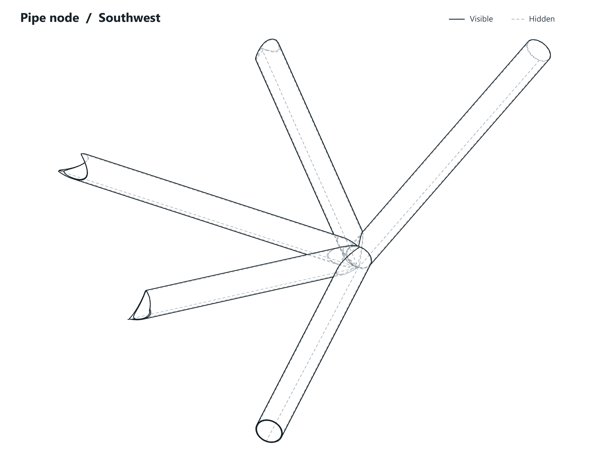

# Pipe-node hidden-line drawing experiment

Can an orthographic drawing classify visibility on the original pipe surfaces quickly enough to beat threaded Rhino HLD? This standalone command extracts one promising approach for review. It runs in a headless Rhino process on Windows.



## Try it

Use .NET 8 x64, a licensed Rhino 8 installation, and a compatible Rhino.Inside resolver. From the repository root, point the command at the resolver and your own millimetre model. A simple input is two intersecting closed cylinders saved as Breps in Rhino. The research fixture contains five closed pipes, five setting-out curves and one point.

```powershell
dotnet build tools/worker-bench -c Release
$env:M2D_RHINO_TESTS = '1'
$resolver = 'C:/path/to/Rhino.Inside_v8_net8.0.dll'
$inputModel = 'C:/models/pipes.3dm'
$drawing = 'C:/models/pipes-sw-drawing.3dm'
dotnet tools/worker-bench/bin/Release/net8.0-windows/M2DPlus.WorkerBench.dll pipe-poc $resolver $inputModel $drawing SW
```

Choose a fresh output filename and either `Top` or `SW`. Open the exported file in Rhino's Top viewport. The drawing lies in World XY. Toggle the Hidden layer to inspect the visible edges. The export includes visible and hidden curves. Loose points appear only when visible. Object names carry the visibility class and source object GUID. The reference image uses dashed strokes for the Hidden layer.

## How it works

1. Collect sharp Brep edges, apparent contours and loose curves. Split their parameter domains at projected boundary crossings and at depth crossings with other bodies.
2. Classify the intervals by shooting orthographic rays. Plane and cylinder equations handle the common faces. Translated quadratic profiles cover several saddle faces. Rhino trimmed-face intersections handle the remaining surface cases.
3. Refine short edges near contact, trim the original curves, and project them. Independent curves are classified on up to eight threads. On AVX2-capable machines four face bounds and cylinder exit depths can be tested per batch. Other machines use scalar arithmetic.

## Evidence and limits

On the five-pipe fixture, the research harness measured first-drawing medians of **198 ms custom versus 425 ms native in Top**, and **148 ms versus 452 ms in SW**. Each figure covers six fresh Rhino 8.36 hosts on a Ryzen AI Max+ 395 with a ReadyToRun build. Timing covered the complete drawing calculation and excluded host startup, model loading and disk writes. One of the six Top pairs missed the 2× target. The source model and benchmark archives live outside the repository.

A separate smoke test ran this extracted command on the same fixture. SW produced 94 visible and 153 hidden curves. Top produced 112 visible and 132 hidden curves. Both matched the audited drawing's source IDs and classes. At 33 stations per curve the maximum positional difference after aligning the drawing planes was below 5 × 10⁻¹¹ mm on both views. The timing medians above belong to the research harness.

The demo covers opaque, closed, valid Breps with optional loose curves and points in millimetres. Projected silhouettes, depth-event sampling and near-contact refinement can miss short intervals. Sections, blocks, arbitrary freeform drawings and Grasshopper integration have additional requirements. Shipping drawings continue to use Rhino HLD.
